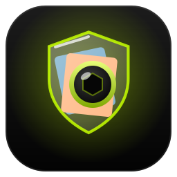
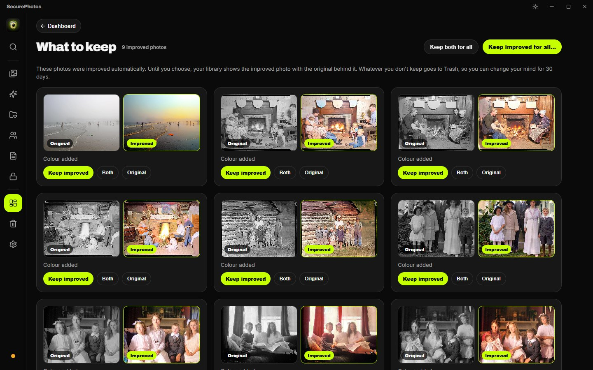

  

<h1 align="center">SecurePhotos</h1>

SecurePhotos keeps your photos, videos and documents on your own computer or external drive. Nothing is uploaded, there is no account to create and no subscription to pay.

It sorts your photos by date, finds the people in them, picks out documents and receipts, brings old prints back to life, and keeps private files in a locked vault. All of this runs on your computer.

If you want to build or change the app, start with the [developer guide](docs/development.md).

## A look inside

| | |
| --- | --- |
|  |  |
| Old prints, brought back in colour. The original is always kept. | Stories made from your photos. |

The screenshots use free sample photos, none of them personal; see [the credits](docs/images/CREDITS.md).

## What it does

### Your library, on your drive
SecurePhotos is made to live on an external drive. Install it there, and the app and everything it keeps sit together on the drive: your photos, the vault, thumbnails and the app's own data. Plug the drive into another Windows computer, open SecurePhotos from the drive and carry on where you left off. Nothing needs to be installed on that computer first.

The first time you use a computer, SecurePhotos asks whether it should improve your photos there too, or only let you view them. If it should, it takes half a minute to get to know the computer and uses its graphics card wherever that is faster. Settings, under Storage, lists every computer your drive has been plugged into, so you can change your mind at any time.

### Bringing photos in
Choose files or a folder, or drop them on the window. SecurePhotos copies them into your library and leaves your originals where they are. If you prefer, it can remove each original once its copy has been checked. Photos you already have are skipped.

After an import, each new photo is prepared in the background. You can use your photos while this happens:

1. The text in it is read, so documents and receipts are found and can be searched.
2. Faces are found, so People fills in.
3. Old prints are checked for missing colour, fading and scratches.
4. Duplicates are looked for.
5. The photo is made sharper and saved in a lighter format. With **Auto**, the default, full-size photos are kept at 8K and smaller ones (like WhatsApp photos) at 4K; you can also choose 2K, 4K or 8K.

A small ring on each photo shows its progress. Videos are prepared after the photos.

### Old photos
SecurePhotos can add colour to black-and-white prints, bring back faded colours, sharpen blurry faces and remove scratches and spots. It always keeps the original next to the improved copy, so you can compare them and choose which to keep. Not happy with a result? **Try again** makes it again from the original with other settings, such as the other colour style, and lets you keep whichever you prefer. You decide in Settings whether improving happens only when you ask or automatically.

### People
Name a face once and SecurePhotos finds that person across your library. You can mark close family and friends, merge groups that turn out to be the same person, and remove anything that was wrongly taken for a face.

### Documents
Receipts, tickets, IDs and other paperwork are separated from your memories, and the words printed on them can be searched.

### Stories and albums
SecurePhotos suggests stories from your trips, the people you love, this week in past years and old photos it has restored. Save the ones you like. Three songs come with the app, so every story has music; add your own in Settings, under Music, and they are used first. You can also make albums of your own and save suggested collages.

### Private Vault
Keep sensitive photos and documents behind a password. Add them straight to the vault with **Add photos**, or move them in from your library. By default the originals are removed from where they were once their locked copy is checked, so no unprotected copy stays behind; you can change that in Settings. Select photos in the vault to move them back to your library or to Trash. Vault files are encrypted, and they are only decrypted in memory while you look at them. A 4-digit PIN reopens the vault quickly while the app stays open. If you forget your password, the Emergency Card you saved during setup is the only way back in.

### Keeping things tidy
The Dashboard shows what's in your library: photos from this week in earlier years, what you just added, an old photo brought back, the people you photograph most and your year month by month. It also points you to duplicates you can remove, improved photos still waiting for your choice, and large videos that can be made smaller. Deleted items stay in Trash for 30 days before they are removed for good.

## Getting started

1. Plug in your external drive, then run the installer, `SecurePhotos_<version>_x64-setup.exe`. It suggests a folder on the drive; keep it, or pick another. You can install on the computer itself instead, but then your library stays on that computer. The installer needs an internet connection once, to download the old-photo models (about 2.7 GB).
2. On any other computer, open `SecurePhotos.exe` from the folder on your drive.
3. Click **Import** and choose your photos, or drop a folder on the window.
4. Browse your photos, name the faces in **People**, and move anything private into the **Private Vault**.

SecurePhotos runs on 64-bit Windows 10 and 11. It works on an ordinary computer; a graphics card is not needed, but when there is one (NVIDIA, AMD or Intel), SecurePhotos uses it wherever it makes photo fixes faster.

## Keyboard shortcuts

| Keys | What it does | Where |
| --- | --- | --- |
| Ctrl + K | Search | Anywhere |
| T | Switch between light and dark | Anywhere |
| Esc | Close the current menu or dialog, then clear the selection | Anywhere |
| ← / → (or K / J) | Previous or next photo | Photo viewer |
| + / − / 0 | Zoom in, zoom out, back to fit | Photo viewer |
| F | Add to or remove from favourites | Photo viewer |
| I | Show or hide the photo's details | Photo viewer |
| Delete | Move to Trash | Photo viewer |
| L | Move to the vault; while the vault is open, lock it | Photo viewer, anywhere |
| P | Hide everything on screen (privacy shield) | Private Vault |

Shortcuts are ignored while you type in a text box.

## Your privacy

- **Your photos stay yours.** They are kept in standard formats in your own library folder, so you are never locked in.
- **It works offline.** Face recognition, text reading and photo enhancement all run on your computer. When you are online, the app only checks GitHub for a newer version, and downloads the old-photo models if the installer couldn't. Nothing about you or your library is sent.
- **Nothing is collected.** There are no analytics, no usage tracking and no error reports sent anywhere.

## Keep a backup

SecurePhotos replaces each imported photo with its enhanced version, and the vault can only be opened with your password or Emergency Card. Please keep your own backup of your original photos and videos on a separate drive.

## More information

- [Changelog](CHANGELOG.md): what changed in each version
- [Security](SECURITY.md): how your data is protected, and how to report a security problem
- [Contributing](CONTRIBUTING.md): how to help
- [Developer guide](docs/development.md), [architecture](docs/architecture.md) and [design system](docs/design_system.md): for developers

## Licence

SecurePhotos is free software under the [MIT License](LICENSE). You keep full ownership of every photo, video and document you add to it.

The songs that come with the app (Between the Frames, Sunday on the Veranda, Where We Once Stood) are by Sumit Kanchan and are shared under the same licence.

The app is provided as it is, without any warranty. Its authors are not responsible for lost or damaged photos, videos or files, loss of quality from enhancement or compression, failing drives, or vault contents that can't be opened because a password or Emergency Card was lost. Keep your own backups.
