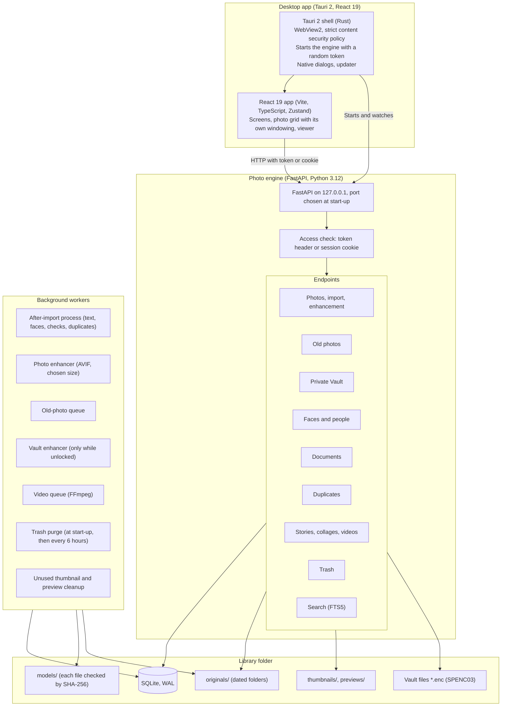
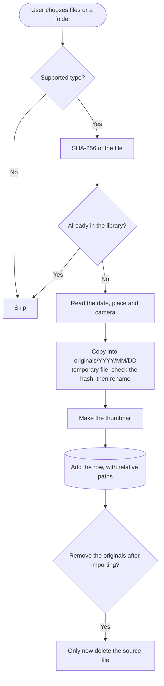
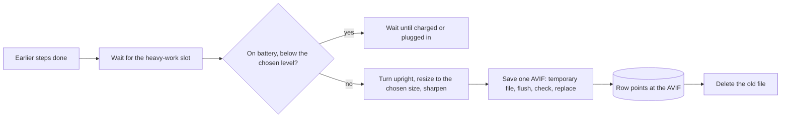
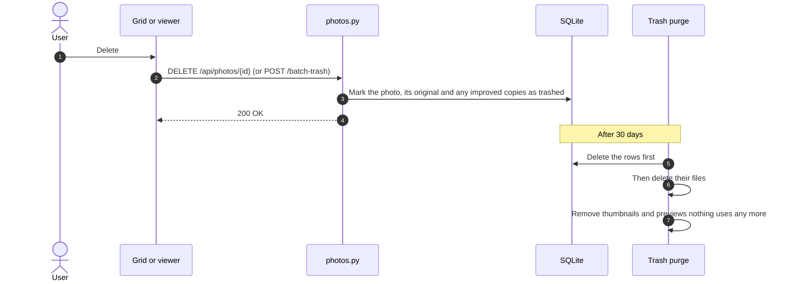

# Architecture

This document explains how SecurePhotos works inside: the parts it is made of, what happens to a photo from import to enhancement, how the vault keeps files safe and how deletion works. [development.md](development.md) covers running and building the app.

## 1. Principles

1. **The user's data stays with the user.** There is no tracking and nothing is uploaded. The app only goes online to check for a newer version and, if the installer couldn't, to download the old-photo models.
2. **Large libraries stay fast.** Libraries of 100,000 photos are expected. Slow work (images, files, AI) runs off the engine's request loop, and heavy work runs one job at a time.
3. **The vault is properly encrypted.** Vault files use AES-256-GCM with a key per file; the master key comes from the user's password through Argon2id; viewing decrypts in memory.
4. **A library can move.** The database, photos, thumbnails and models live in one library folder, and paths are stored relative to it, so the folder can travel on an external drive.
5. **It runs on an ordinary computer.** Every AI model is chosen and tuned to run on a CPU. A graphics card helps but is never required.

## 2. The parts



**One engine, and it ends with the app.** The shell starts one engine at a time and never while its engine is still running. The engine runs inside a Windows Job Object set to stop its processes when the job closes; the shell holds the only handle, so when the app ends in any way, including a crash or a forced close, Windows stops the engine and any FFmpeg it started (`src-tauri/src/job.rs`). As a second line, the engine checks every second that the app's process (`SECUREPHOTOS_PARENT_PID`) is still running and shuts itself down when it isn't (`engine/services/parent_watch.py`). Either way nothing is left holding files open on the drive, so Windows can eject it.

## 3. How things work

### 3.1 Import



- An import always copies into the library; there is no "use in place" mode. One import runs at a time.
- Each new photo then goes through the after-import process (3.2).

### 3.2 After an import

Every photo goes through the same steps, in this order. Each step is recorded on the photo, so nothing is skipped or done twice, even if the app closes halfway.

1. **Read the text** with the OCR built into Windows. Documents and receipts are found from it, and the text becomes searchable.
2. **Find faces** (YuNet and SFace). Documents are skipped.
3. **Check old prints:** the old-photo rules decide whether a scan needs colour, fading fixed, faces sharpened or scratches removed. Depending on Settings this happens automatically or only when the user asks.
4. **Fingerprint for duplicates** (a dHash of the thumbnail).
5. **Enhance** to the chosen photo size (3.4).

Steps 1 to 4 are quick (under a second each) and run for every new photo first, newest first, so People, Documents and duplicates are ready within minutes of a large import. Enhancement follows, one photo at a time. Photos that need the least work go first; old prints that need fixing go last. When a run ends, duplicates are regrouped and stories are suggested.

The grid shows a progress ring on each photo still being prepared, with the steps shown as icons. The step a photo is on is sent to the app as part of the photo grid's data.

### 3.3 One heavy job at a time

Enhancement, old-photo fixes, video work and the vault enhancer would each use every CPU core. They share one slot (`engine/services/cpu_budget.py`) and take turns:

| Priority | Work |
| --- | --- |
| 1 (first) | An old-photo fix the user asked for |
| 2 | Automatic old-photo fixes |
| 3 | Photo enhancement |
| 4 | Automatic video work and the vault enhancer |

A job is never interrupted; the slot passes on when it finishes. A video the user enhances or makes smaller from the Big videos page takes the slot too, ahead of automatic work. Two extra rules keep the order sensible: automatic old-photo fixes wait while plain photos are being enhanced, and automatic video work waits while any photo is still being prepared. All of it pauses when the computer runs on battery below the level chosen in Settings. It also waits on a computer set to "Only views": every computer the drive has been plugged into is listed in the `computers` table with its choice (always does the work, asks each time, or only views), asked once on a new computer and changed in Settings → Storage ([computers.py](../engine/services/computers.py)). The quick steps after an import, and anything the user starts, run on every computer.

### 3.4 Photo enhancement



- Each photo is enhanced once, and the AVIF replaces the imported file. Camera details, the date and the place are kept.
- **Photo size** (Settings) sets the long side: 2K is 2560 px, 4K is 3840 px and 8K is 7680 px. Smaller photos are enlarged to it and larger ones reduced. **Auto**, the default, decides per photo when it is enhanced: 6 MP and up (phone and camera originals, scans) get 8K, smaller ones get 4K (`auto_long_edge` in `enhancement_service.py`). **Photo quality** (Best, Balanced, Smaller) sets the AVIF quality.
- **How it enlarges:** a high-quality resize (Lanczos) and a fine-edge sharpen, not an AI model; on a CPU that takes seconds per photo. The 8K print-ready copy is the exception: it is made on request with Real-ESRGAN (about 40 s on a CPU) for crisper edges on large prints, falling back to the resize if the model can't be used. Using Real-ESRGAN for the library itself needs a graphics card (planned).
- This step uses Lanczos resizing and sharpening, not an AI model.
- **Old photos** are fixed before enhancement, at the scan's own size, by AI models (DDColor for colour, GFPGAN for faces, a scratch detector with LaMa for scratches). The improved photo is saved as a copy linked to its original (`derived_from_id`); both are then enhanced, so they compare like for like. The grid shows one tile per pair.
- **Videos** follow Settings, Video size: as recorded, HD (old low-quality clips enlarged to 1080p), 2K or 4K, measured on the shorter side. Nothing goes above 4K.

### 3.5 Search


Search matches words (FTS5) and applies filters. There is no search by meaning yet.

### 3.6 The vault

```mermaid
sequenceDiagram
    autonumber
    actor User
    participant UI as App (Private Vault)
    participant API as Vault endpoints
    participant State as Session in memory (master key)
    participant Crypto as crypto_vault / vault_storage
    participant Disk as Library folder

    Note over User,Disk: 1. Unlock
    User->>UI: Master password (or the PIN after a normal lock, or the Emergency Card)
    UI->>API: POST /api/vault/unlock
    API->>Crypto: Argon2id(password, salt), then unwrap the master key (AES-256-GCM)
    API->>State: Keep the master key in memory; lock after the chosen idle time

    Note over User,Disk: 2. Move a photo into the vault
    User->>UI: Select a photo, then Move to Vault
    UI->>API: POST /api/vault/photos/lock
    API->>Crypto: Write a journal entry, then encrypt (one vault job at a time)
    Crypto->>Crypto: File key = HKDF(master key, random salt); 64 KB chunks, AES-256-GCM
    Crypto->>Disk: Write SPENC03 (temporary file, flush, replace) and check it decrypts
    Crypto->>Disk: Save the row, then delete the original; seal its text and GPS position
    API-->>UI: 200 OK

    Note over User,Disk: 3. View a vault photo or video
    User->>UI: Open a vault photo
    UI->>API: GET /api/vault/stream/{id}
    API->>Crypto: decrypt_file_chunked_stream(file.enc, master key)
    Crypto->>Disk: Read the chunks and check each tag; refuse a missing last chunk, extra data or an old format
    Crypto-->>UI: Stream the decrypted bytes (no decrypted file on disk)
```

**Adding straight to the vault.** An import with `into_vault` saves each photo as "on its way into the vault" (`is_encrypted = 2`), which no library or vault view shows and no worker touches, then encrypts it at once with the same crash-safe lock step ([vault_import.py](../engine/services/vault_import.py)). Only after that, and only if asked (Settings → Vault, on by default), is the original removed. A stop half-way is undone at the next start: the half-imported copy is removed and the original is still where it was. Every vault step re-reads the photo once it is its turn in the one-at-a-time vault queue, because the vault enhancer may have rewritten it meanwhile. Setting up a vault again is refused while one exists, since a new key would make the photos in it unreadable.

#### The vault key in memory: what is and isn't protected

- **Protected:** the app never writes the master vault key to disk, and the vault files are useless without it. While the vault is open, the key lives in one session buffer. When the vault locks fully (no PIN set, or the PIN locked out), the buffer is overwritten with zeros and dropped. With a PIN set, a normal lock keeps the key in memory so the PIN can reopen the vault until the app closes. When the app closes, the shell ends the engine process and Windows clears its memory before reusing it; on a clean engine shutdown the engine also overwrites the key itself first.
- **Not guaranteed:** Python and the cryptography library make short-lived copies of the key (one per request, plus the cipher's own). Python can't overwrite those; they stay in freed memory until it is reused. Windows may also write memory to the page file or the hibernation file.
- **So:** someone who can read the computer's memory or page file while the app runs could find the key. Lock the vault when stepping away, and use full-disk encryption (such as BitLocker) so the page file and hibernation file are encrypted too.

### 3.7 Trash



- Every library view, search, album and face group leaves out trashed photos (`trashed_at IS NULL`).
- A photo and its improved copies are deleted and restored together.
- Rows are deleted before files, so a crash can leave a stray file but never a row pointing at a missing one.

### 3.8 The Dashboard

The Dashboard reads, it never changes anything. Besides the counts (`GET /api/system/dashboard`) and the jobs' own summaries, one call, `GET /api/system/highlights` (`engine/services/highlights.py`), gives every tile what it shows:

- **On this day:** this week (3 days either side of today) in the earlier year with the most photos, using the same photo rules as the "On this day" stories, and that story's id when it exists.
- **Just added:** photos and videos added in the last 24 hours (improved copies are not imports), and how many are still being prepared.
- **Brought back:** the newest old photo the app improved, with its original as the "before". The original may be in Trash after "Replace".
- **People:** the 6 people with most photos, close ones first, and how many groups of faces wait for a name.
- **Your year:** tiles per month as the Photos grid shows them, so each bar's number matches the month it opens.
- **Trash:** how many items and their size, for "Empty Trash" under Worth doing.

Vault photos are never included. Storage detail lives in Settings › Storage; the Dashboard keeps one line.

## 4. The database

The schema and its migrations are in [engine/database.py](../engine/database.py), the single source of truth. The main tables:

| Table | Holds |
| --- | --- |
| `photos` | Every photo, video and document: file, dates, camera, place, flags (favourite, vault, document), the after-import steps done, links between originals and improved copies, trash dates |
| `faces`, `persons` | Faces found in photos and the people they belong to |
| `albums`, `photo_album` | Albums and their photos |
| `document_folders`, `photo_document_folder` | Document folders |
| `duplicate_groups` | Groups of exact copies and similar shots |
| `stories`, `story_items`, `story_dismissals` | Suggested and saved stories, and suggestions the user deleted |
| `restore_jobs` | Old-photo fixes waiting, running and done |
| `computers` | Every computer the drive has been plugged into, and whether it does the background work |
| `video_processing_queue` | Automatic video work |
| `vault_configs`, `vault_pending_ops` | The wrapped vault keys and the PIN check; a journal so an interrupted vault move can be finished or undone |
| `app_settings` | Settings, stored in the library so they travel with it |
| `photos_fts` | The full-text search index |

[database_schema.md](database_schema.md) describes the database settings, indexes and search in more detail.
