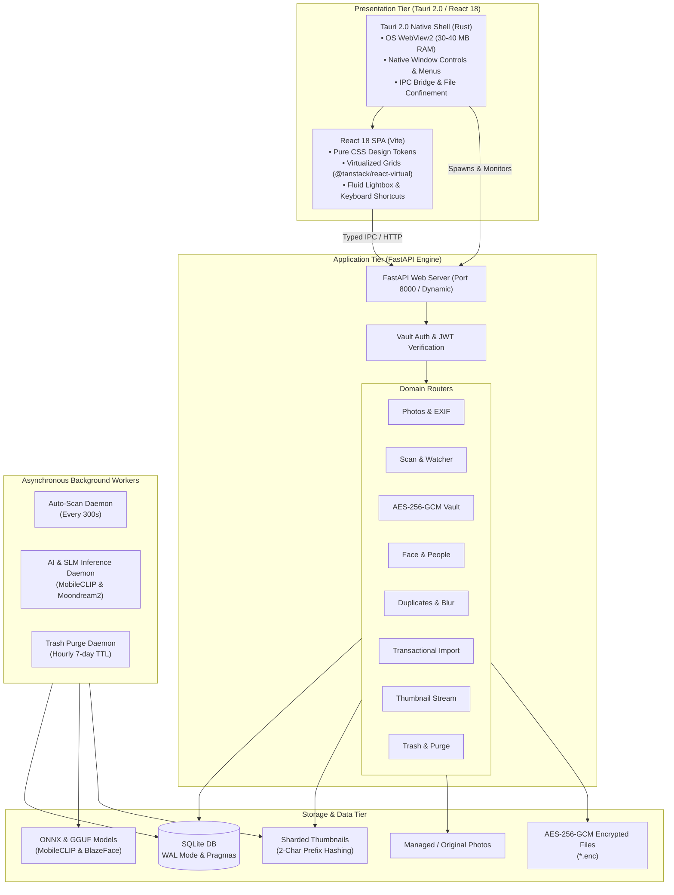
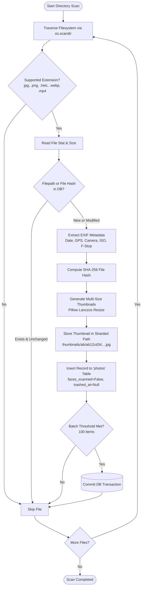
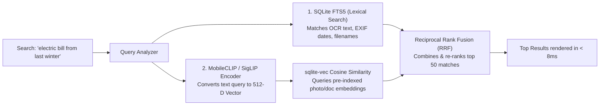
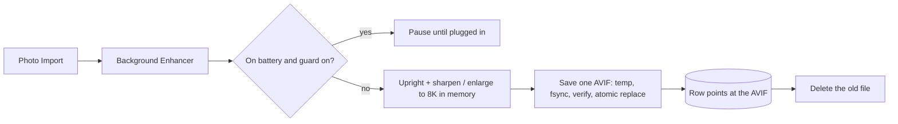
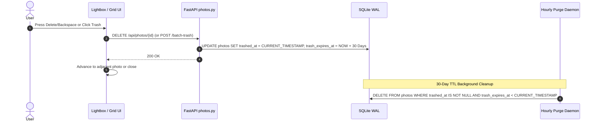
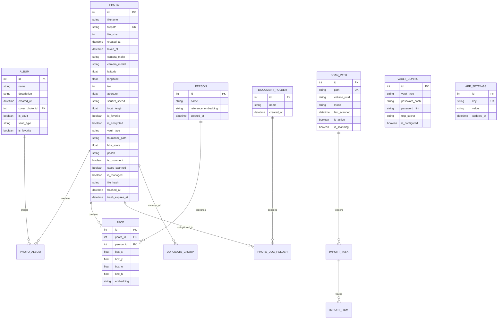

# 📐 SecurePhotos: System Architecture & Technical Design

---

## 1. Architectural Philosophy & Core Principles

SecurePhotos is designed as an **offline-first, zero-cloud personal media vault**. The system prioritizes:
1. **Data Sovereignty & Zero Trust**: No telemetry, no cloud dependencies, and zero external network calls.
2. **High Scale & Low Latency**: Lightning-fast access across libraries containing 100,000+ high-resolution photos and videos.
3. **Defense-in-Depth Cryptography**: Strong at-rest encryption (AES-256-GCM with PBKDF2/Argon2id key derivation) and ephemeral in-memory decryption.
4. **Drive Portability**: Database, caches, and thumbnails live within a self-contained directory tree that can travel with external hard drives and SSDs.

---

## 2. High-Level System Architecture



---

## 3. Subsystem Workflows & Flowcharts

### 3.1 Photo Ingestion & Indexing Pipeline



---

### 3.2 Dual Hybrid Search Pipeline (FTS5 + Vector)



---

### 3.3 Encrypted Vault Security Lifecycle

```mermaid
sequenceDiagram
    autonumber
    actor User
    participant UI as React UI (Vault Page)
    participant Auth as Vault Controller
    participant State as In-Memory State (_vault_sessions)
    participant Crypto as Vault Crypto Engine (AES-GCM)
    participant Disk as Encrypted Storage (.enc)

    Note over User,Disk: 1. Authentication & Unlock
    User->>UI: Enter Vault Password (+ TOTP if enabled)
    UI->>Auth: POST /vault/verify {password, totp_code}
    Auth->>Auth: Validate bcrypt hash & TOTP token
    Auth->>State: Store password in-memory with session_id & 5-min TTL
    Auth->>UI: Return JWT Token {sid: session_id, exp}

    Note over User,Disk: 2. Locking a Photo into the Vault
    User->>UI: Select photo -> "Move to Vault"
    UI->>Auth: POST /photos/{id}/lock (Bearer JWT)
    Auth->>State: Verify JWT & retrieve in-memory password
    Auth->>Crypto: encrypt_file_streaming(photo.filepath, password)
    Crypto->>Crypto: Derive Key via Argon2id / PBKDF2
    Crypto->>Crypto: Per-file key = HKDF(vault key, random file salt); 64 KB chunks, AES-256-GCM
    Crypto->>Disk: Write SPENC03 header (magic + file salt) + chunks (counter + last-chunk flag in nonce, header authenticated)
    Crypto->>Disk: Securely delete unencrypted original
    Auth->>UI: Return 200 OK

    Note over User,Disk: 3. Viewing Encrypted Photo / Streaming
    User->>UI: Open Vault Thumbnail / Lightbox
    UI->>Auth: GET /photos/{id}/vault-raw (Bearer JWT)
    Auth->>State: Validate JWT session
    Auth->>Crypto: decrypt_file_stream(filepath.enc, password)
    Crypto->>Disk: Read chunks, verify each tag; reject missing last chunk, extra data or old formats
    Crypto-->>Auth: Stream decrypted chunk buffer to HTTP response
    Auth-->>UI: Image/Video renders smoothly (Zero Disk Footprint)
```

---

### 3.3 Single-Version Photo Enhancement Pipeline



- Every imported photo is enhanced once and the AVIF replaces the original (one version per photo). Camera details are kept; quality follows the Settings slider.
- No AI model is used in this pipeline. Blurry-face restoration was removed (no permissively licensed model); see `THIRD_PARTY_NOTICES.md`.
- Details: `.agents/history/features_and_functional_decisions.md` §102.

---

### 3.4 Soft-Delete Trash & Retention Lifecycle



- **Query Isolation**: All library grids, searches, albums, and facial clusters enforce `WHERE trashed_at IS NULL`.
- **Restoration Guarantee**: Photos remain safely restorable for 30 days before permanent file system unlinking.

---

## 4. Database Schema (Entity-Relationship Model)


