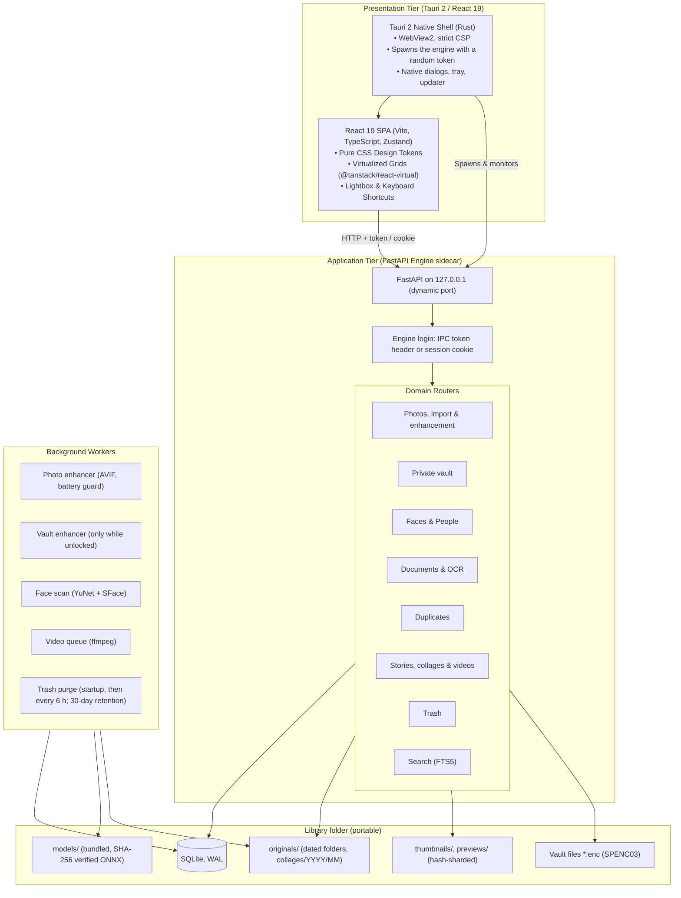
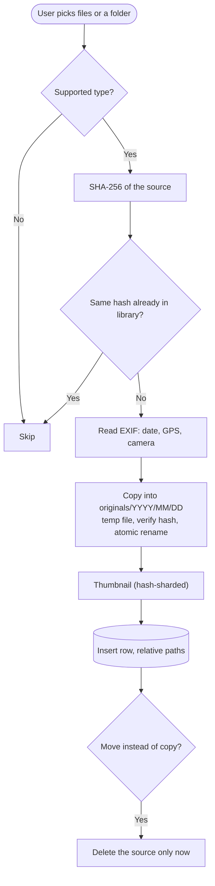
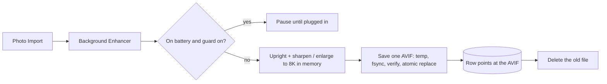
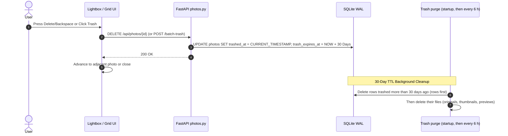
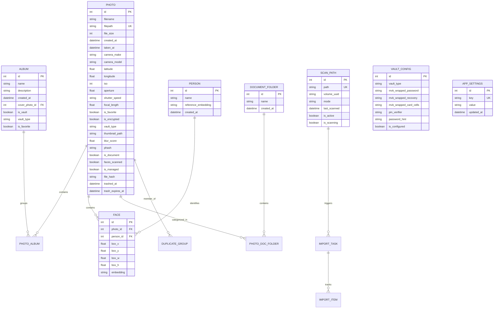

# 📐 SecurePhotos: System Architecture & Technical Design

---

## 1. Architectural Philosophy & Core Principles

SecurePhotos is designed as an **offline-first, zero-cloud personal media vault**. The system prioritizes:
1. **Data Sovereignty**: No telemetry and no uploads. The AI models ship with the app; the only automatic network call is the update check (GitHub's latest-version file).
2. **High Scale & Low Latency**: Fast access across libraries of 100,000+ photos and videos; heavy work runs off the engine's request loop (H7).
3. **Defense-in-Depth Cryptography**: Vault files use AES-256-GCM (SPENC03, per-file keys); keys are derived with Argon2id; viewing decrypts in memory.
4. **Drive Portability**: Database, media, thumbnails and models live in one library folder with paths stored relative to it, so it can travel on an external drive.

---

## 2. High-Level System Architecture



---

## 3. Subsystem Workflows & Flowcharts

### 3.1 Photo Import Pipeline



- Imports always copy into the library; there is no in-place mode (M4). One import batch runs at a time and file work runs off the request loop (H7). Each photo is enhanced afterwards (§3.4).

---

### 3.2 Search


- Search is lexical (FTS5) plus filters. There is no vector or AI search today; see the `sqlite-vector-search` skill for future ideas.

---

### 3.3 Encrypted Vault Security Lifecycle

```mermaid
sequenceDiagram
    autonumber
    actor User
    participant UI as React UI (Vault Page)
    participant API as Vault API
    participant State as In-memory session (master key)
    participant Crypto as crypto_vault / vault_storage
    participant Disk as Library folder

    Note over User,Disk: 1. Unlock
    User->>UI: Master password (or PIN after a normal lock, or the emergency card)
    UI->>API: POST /api/vault/unlock (engine token / cookie)
    API->>Crypto: Argon2id(password, salt) -> unwrap master key (AES-256-GCM)
    API->>State: Keep the master key in memory; auto-lock after the configured idle time

    Note over User,Disk: 2. Move a photo into the vault
    User->>UI: Select photo -> "Move to Vault"
    UI->>API: POST /api/vault/photos/lock
    API->>Crypto: Journal, then encrypt (off the request loop, one vault job at a time)
    Crypto->>Crypto: Per-file key = HKDF(master key, random file salt); 64 KB chunks, AES-256-GCM
    Crypto->>Disk: Write SPENC03 (temp, fsync, replace) and verify it decrypts
    Crypto->>Disk: Commit the row, then delete the original; seal OCR text + GPS
    API-->>UI: 200 OK

    Note over User,Disk: 3. View a vault photo / video
    User->>UI: Open vault thumbnail / lightbox
    UI->>API: GET /api/vault/stream/{id}
    API->>Crypto: decrypt_file_chunked_stream(file.enc, master key)
    Crypto->>Disk: Read chunks, verify each tag; reject missing last chunk, extra data or old formats
    Crypto-->>UI: Stream decrypted bytes (no decrypted file on disk)
```

#### Vault key in memory (what is and isn't protected)

- **Protected:** the master vault key is never written to disk by the app; the vault files on disk are useless without it. While the vault is open, the key lives in one session buffer. When the vault fully locks (no PIN set, or the PIN is locked out), that buffer is overwritten with zeros and dropped. With a PIN set, a normal lock keeps the key in memory so the PIN can reopen the vault until the app closes. When the app closes, the app shell ends the engine process and Windows clears that process's memory before reusing it; on a graceful engine shutdown (e.g. in development) the engine also overwrites the key itself first.
- **Not guaranteed:** Python and the cryptography library make short-lived copies of the key (one per request, plus the cipher's own copy). Python cannot overwrite those; they stay in freed memory until it is reused. Windows may also write memory to the page file or hibernation file.
- **So:** someone who can read this PC's memory or its page file while the app is running could find the key. Lock the vault when stepping away, and use full-disk encryption (e.g. BitLocker) so the page file and hibernation file are encrypted too.

---

### 3.4 Single-Version Photo Enhancement Pipeline



- Every imported photo is enhanced once and the AVIF replaces the original (one version per photo). Camera details are kept; quality follows the Settings slider.
- No AI model is used in this pipeline. Blurry-face restoration was removed (no permissively licensed model); see `THIRD_PARTY_NOTICES.md`.
- Details: `.agents/history/features_and_functional_decisions.md` §102.

---

### 3.5 Soft-Delete Trash & Retention Lifecycle



- **Query Isolation**: All library grids, searches, albums, and facial clusters enforce `WHERE trashed_at IS NULL`.
- **Restoration Guarantee**: Photos remain safely restorable for 30 days before permanent file system unlinking.

---

## 4. Database Schema (Entity-Relationship Model)


