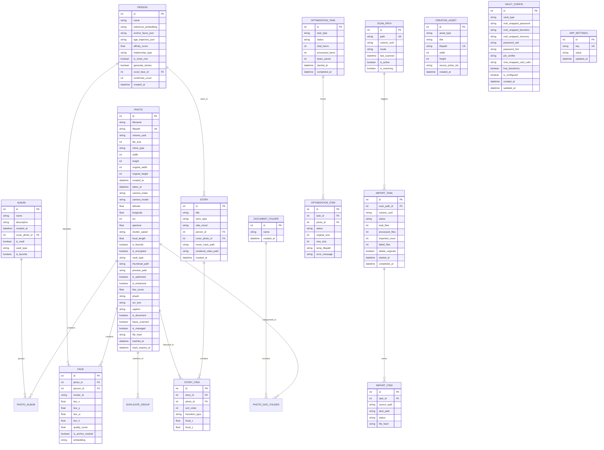

# 🗄️ SecurePhotos: Database Schema & Indexing Architecture

> **High-scale SQLite relational engine, composite covering indexes, full-text FTS5 search, multi-slot zero-trust vault, social affinity graph, and creative montage asset specifications for 100,000+ media records.**

---

## 1. Engine Configuration & SQLite Pragmas

To achieve single-digit millisecond query latency across 100,000+ photos on standard NVMe/SSD or External USB 3.0/Type-C storage, the SQLite connection executes these pragmas at boot:

```sql
PRAGMA journal_mode = WAL;          -- Write-Ahead Logging for concurrent reads while background workers write
PRAGMA synchronous = NORMAL;        -- Optimal durability without disk flush latency on every write
PRAGMA cache_size = -64000;         -- 64 MB dedicated in-memory page cache
PRAGMA temp_store = MEMORY;         -- Store temp tables, indices, and sorting runs in RAM
PRAGMA mmap_size = 268435456;       -- 256 MB memory-mapped file access for fast sequential scans
PRAGMA busy_timeout = 5000;         -- Wait up to 5000ms on table lock before raising busy error
PRAGMA foreign_keys = ON;           -- Enforce relational foreign key constraints
```

---

## 2. Entity-Relationship Schema



---

## 3. Relational Table Definitions (DDL)

```sql
-- ── 1. Photos Table ──────────────────────────────────────────────────────────
CREATE TABLE IF NOT EXISTS photos (
    id INTEGER PRIMARY KEY AUTOINCREMENT,
    filename TEXT NOT NULL,
    filepath TEXT NOT NULL UNIQUE,
    volume_uuid TEXT,               -- Unique identifier of physical volume/disk
    file_size INTEGER NOT NULL,
    mime_type TEXT DEFAULT 'image/jpeg',
    width INTEGER,
    height INTEGER,
    original_width INTEGER,         -- Pre-enhancement dimensions
    original_height INTEGER,
    created_at DATETIME DEFAULT CURRENT_TIMESTAMP,
    taken_at DATETIME,
    camera_make TEXT,
    camera_model TEXT,
    latitude REAL,
    longitude REAL,
    iso INTEGER,
    aperture REAL,
    shutter_speed TEXT,
    focal_length REAL,
    is_favorite BOOLEAN DEFAULT 0,
    is_encrypted BOOLEAN DEFAULT 0,
    encryption_key_id TEXT,
    vault_type TEXT,                -- 'documents' | 'private' | NULL
    thumbnail_path TEXT,            -- Sharded relative path: 'thumbnails/ab/ab12cd....webp' (or .enc if vault)
    preview_path TEXT,              -- 2K/4K fast display proxy: 'previews/ab/ab12cd....avif' (or .enc if vault)
    is_optimized BOOLEAN DEFAULT 0, -- 1 if compressed via AVIF/AV1/H.265
    is_enhanced BOOLEAN DEFAULT 0,  -- 1 if upscaled via AI Super-Resolution
    blur_score REAL,
    phash TEXT,
    ocr_text TEXT,                  -- Extracted text from documents/receipts
    caption TEXT,                   -- AI-generated scene description
    content_tags TEXT,              -- Comma-separated or JSON tags
    quality_score REAL,
    is_document BOOLEAN DEFAULT 0,
    sensitivity_reviewed BOOLEAN DEFAULT 0,
    faces_scanned BOOLEAN DEFAULT 0,
    is_managed BOOLEAN DEFAULT 0,
    original_path TEXT,
    file_hash TEXT,                 -- SHA-256 checksum for deduplication & verification
    folder_name TEXT,
    trashed_at DATETIME,
    trash_expires_at DATETIME,
    derived_from_id INTEGER REFERENCES photos(id) ON DELETE SET NULL, -- H10: improved copy of this original
    ai_kind TEXT,                   -- H10: 'colour' | 'fade' | 'faces' | 'scratches' (comma-joined when combined)
    ai_params TEXT,                 -- H10: JSON settings used, e.g. {"style": "natural"}
    edited_at DATETIME,             -- H10: when the improved copy was made
    choice_pending INTEGER NOT NULL DEFAULT 0 -- A8: kept by an automatic rule; the owner hasn't chosen
                                    -- improved / original / both. Migration marks earlier automatic copies.
);
-- A8: the library lists one tile per group (photo_versions.stack_top): an original with an
-- improved copy outside Trash is hidden behind it, and of several copies only the newest shows.

-- ── 2. Albums Table ──────────────────────────────────────────────────────────
CREATE TABLE IF NOT EXISTS albums (
    id INTEGER PRIMARY KEY AUTOINCREMENT,
    name TEXT NOT NULL,
    description TEXT,
    created_at DATETIME DEFAULT CURRENT_TIMESTAMP,
    cover_photo_id INTEGER REFERENCES photos(id) ON DELETE SET NULL,
    is_vault BOOLEAN DEFAULT 0,
    vault_type TEXT,
    is_favorite BOOLEAN DEFAULT 0
);

-- ── 3. Photo ↔ Album Junction ────────────────────────────────────────────────
CREATE TABLE IF NOT EXISTS photo_album (
    photo_id INTEGER NOT NULL REFERENCES photos(id) ON DELETE CASCADE,
    album_id INTEGER NOT NULL REFERENCES albums(id) ON DELETE CASCADE,
    added_at DATETIME DEFAULT CURRENT_TIMESTAMP,
    PRIMARY KEY (photo_id, album_id)
);

-- ── 4. Persons Table (Social Affinity & Life-Stage Linked) ────────────────────
CREATE TABLE IF NOT EXISTS persons (
    id INTEGER PRIMARY KEY AUTOINCREMENT,
    name TEXT NOT NULL,
    reference_embedding TEXT,       -- JSON centroid embedding (128-D SFace since H9)
    anchor_faces_json TEXT,         -- JSON array of 3-4 representative face IDs (medoids)
    age_trajectory_json TEXT,       -- Chronological life-stage linking graph across years
    affinity_score REAL DEFAULT 0.0,-- Computed score (0.0 to 100.0)
    relationship_type TEXT,         -- 'Family' | 'Partner' | 'Friend' | 'Acquaintance'
    is_close_one BOOLEAN DEFAULT 0, -- 1 if affinity > threshold or user marked ⭐
    generate_stories BOOLEAN DEFAULT 1,
    cover_face_id INTEGER,
    confirmed_count INTEGER DEFAULT 0,
    created_at DATETIME DEFAULT CURRENT_TIMESTAMP
);

-- ── 5. Faces Table ───────────────────────────────────────────────────────────
CREATE TABLE IF NOT EXISTS faces (
    id INTEGER PRIMARY KEY AUTOINCREMENT,
    photo_id INTEGER NOT NULL REFERENCES photos(id) ON DELETE CASCADE,
    person_id INTEGER REFERENCES persons(id) ON DELETE SET NULL,
    cluster_id TEXT,                -- Unsupervised clustering candidate group
    box_x REAL NOT NULL,            -- Relative coordinates (0.0 to 1.0)
    box_y REAL NOT NULL,
    box_w REAL NOT NULL,
    box_h REAL NOT NULL,
    quality_score REAL DEFAULT 1.0, -- Sharpness, illumination & frontal score
    is_anchor_medoid BOOLEAN DEFAULT 0, -- 1 if chosen as a representative card face
    embedding TEXT NOT NULL          -- JSON embedding vector (128-D SFace since H9; see embedding_model)
);

-- ── 6. Stories Table ─────────────────────────────────────────────────────────
CREATE TABLE IF NOT EXISTS stories (
    id INTEGER PRIMARY KEY AUTOINCREMENT,
    title TEXT NOT NULL,
    story_type TEXT NOT NULL,        -- 'through_the_years' | 'duo_moments' | 'on_this_day' | 'adventure'
    vibe_mood TEXT DEFAULT 'acoustic',-- 'acoustic' | 'upbeat' | 'nostalgic' | 'cinematic'
    person_id INTEGER REFERENCES persons(id) ON DELETE CASCADE,
    cover_photo_id INTEGER REFERENCES photos(id) ON DELETE SET NULL,
    music_track_path TEXT,          -- Relative path to bundled or custom soundtrack
    rendered_video_path TEXT,       -- Optional cached 4K MP4 export
    created_at DATETIME DEFAULT CURRENT_TIMESTAMP
);

-- ── 7. Story Items ───────────────────────────────────────────────────────────
CREATE TABLE IF NOT EXISTS story_items (
    id INTEGER PRIMARY KEY AUTOINCREMENT,
    story_id INTEGER NOT NULL REFERENCES stories(id) ON DELETE CASCADE,
    photo_id INTEGER NOT NULL REFERENCES photos(id) ON DELETE CASCADE,
    sort_order INTEGER NOT NULL,
    transition_type TEXT DEFAULT 'crossfade', -- 'crossfade' | 'zoom_in' | 'pan_right'
    focal_x REAL DEFAULT 0.5,       -- Ken-Burns focus point (face center)
    focal_y REAL DEFAULT 0.5
);

-- ── 8. Creative Assets Table (Collages & Wallpapers) ─────────────────────────
CREATE TABLE IF NOT EXISTS creative_assets (
    id INTEGER PRIMARY KEY AUTOINCREMENT,
    asset_type TEXT NOT NULL,        -- 'collage' | 'wallpaper' | 'highlight_montage'
    title TEXT NOT NULL,
    filepath TEXT NOT NULL UNIQUE,   -- 'creatives/collages/2026/summer_collage.avif'
    width INTEGER NOT NULL,
    height INTEGER NOT NULL,
    source_photo_ids TEXT,           -- JSON array of photo IDs used in asset
    created_at DATETIME DEFAULT CURRENT_TIMESTAMP
);

-- ── 9. Document Folders Table ────────────────────────────────────────────────
CREATE TABLE IF NOT EXISTS document_folders (
    id INTEGER PRIMARY KEY AUTOINCREMENT,
    name TEXT NOT NULL UNIQUE,      -- e.g. 'Invoices', 'Passports', 'Receipts'
    created_at DATETIME DEFAULT CURRENT_TIMESTAMP
);

-- ── 10. Photo ↔ Document Folder Junction ─────────────────────────────────────
CREATE TABLE IF NOT EXISTS photo_document_folder (
    photo_id INTEGER NOT NULL REFERENCES photos(id) ON DELETE CASCADE,
    folder_id INTEGER NOT NULL REFERENCES document_folders(id) ON DELETE CASCADE,
    PRIMARY KEY (photo_id, folder_id)
);

-- ── 11. Scan Paths Table ─────────────────────────────────────────────────────
CREATE TABLE IF NOT EXISTS scan_paths (
    id INTEGER PRIMARY KEY AUTOINCREMENT,
    path TEXT NOT NULL UNIQUE,
    volume_uuid TEXT,
    mode TEXT DEFAULT 'scan',       -- 'scan' (in-place) or 'import' (managed library)
    last_scanned DATETIME,
    is_active BOOLEAN DEFAULT 1,
    is_scanning BOOLEAN DEFAULT 0,
    scan_total INTEGER DEFAULT 0,
    scan_processed INTEGER DEFAULT 0
);

-- ── 12. Transactional Import Tasks ───────────────────────────────────────────
CREATE TABLE IF NOT EXISTS import_tasks (
    id INTEGER PRIMARY KEY AUTOINCREMENT,
    scan_path_id INTEGER REFERENCES scan_paths(id) ON DELETE SET NULL,
    scan_path TEXT,
    volume_uuid TEXT,
    status TEXT DEFAULT 'queued',   -- 'queued' | 'scanning' | 'importing' | 'paused' | 'completed' | 'failed'
    total_files INTEGER DEFAULT 0,
    processed_files INTEGER DEFAULT 0,
    imported_count INTEGER DEFAULT 0,
    failed_files INTEGER DEFAULT 0,
    delete_originals BOOLEAN DEFAULT 0,
    started_at DATETIME,
    completed_at DATETIME,
    error_message TEXT
);

-- ── 13. Import Items ─────────────────────────────────────────────────────────
CREATE TABLE IF NOT EXISTS import_items (
    id INTEGER PRIMARY KEY AUTOINCREMENT,
    task_id INTEGER NOT NULL REFERENCES import_tasks(id) ON DELETE CASCADE,
    source_path TEXT NOT NULL,
    dest_path TEXT,
    status TEXT DEFAULT 'pending',  -- 'pending' | 'imported' | 'skipped' | 'failed'
    file_hash TEXT,
    error_message TEXT
);

-- ── 14. Optimization & AI Super-Resolution Tasks ────────────────────────────
CREATE TABLE IF NOT EXISTS optimization_tasks (
    id INTEGER PRIMARY KEY AUTOINCREMENT,
    task_type TEXT NOT NULL,        -- '4k_compress' | 'ai_upscale_and_compress' | 'proxy_gen'
    status TEXT DEFAULT 'queued',   -- 'queued' | 'running' | 'paused' | 'completed' | 'failed'
    total_items INTEGER DEFAULT 0,
    processed_items INTEGER DEFAULT 0,
    bytes_saved INTEGER DEFAULT 0,
    started_at DATETIME,
    completed_at DATETIME,
    error_message TEXT
);

-- ── 15. Optimization Items (Atomic Swap Journal) ────────────────────────────
CREATE TABLE IF NOT EXISTS optimization_items (
    id INTEGER PRIMARY KEY AUTOINCREMENT,
    task_id INTEGER NOT NULL REFERENCES optimization_tasks(id) ON DELETE CASCADE,
    photo_id INTEGER NOT NULL REFERENCES photos(id) ON DELETE CASCADE,
    status TEXT DEFAULT 'pending',  -- 'pending' | 'processing' | 'swapped' | 'failed'
    original_size INTEGER,
    new_size INTEGER,
    temp_filepath TEXT,             -- Temporary .tmp file tracking for crash recovery
    error_message TEXT
);

-- ── 16. Multi-Slot Vault Configurations Table ────────────────────────────────
CREATE TABLE IF NOT EXISTS vault_configs (
    id INTEGER PRIMARY KEY AUTOINCREMENT,
    vault_type TEXT NOT NULL UNIQUE,          -- 'private' or 'documents'
    mvk_wrapped_password TEXT NOT NULL,      -- Master Key encrypted with Argon2id password key
    mvk_wrapped_biometric TEXT,              -- Reserved for Windows Hello (planned, P12); unused
    mvk_wrapped_recovery TEXT NOT NULL,       -- Master Key encrypted with the emergency card token key
    password_salt TEXT NOT NULL,             -- Randomized 16-byte salt for Argon2id
    password_hint TEXT,
    totp_secret_encrypted TEXT,              -- Unused since H3 (TOTP removed); always NULL
    -- Added by migrations: pin_verifier (Argon2id PIN check), mvk_wrapped_card_cells + card_cells_salt (16 card numbers), grid_* (card)
    has_biometrics BOOLEAN DEFAULT 0,
    is_configured BOOLEAN DEFAULT 0,
    created_at DATETIME DEFAULT CURRENT_TIMESTAMP,
    updated_at DATETIME DEFAULT CURRENT_TIMESTAMP
);

-- ── 17. App Settings Table ──────────────────────────────────────────────────
CREATE TABLE IF NOT EXISTS app_settings (
    id INTEGER PRIMARY KEY AUTOINCREMENT,
    key TEXT NOT NULL UNIQUE,
    value TEXT NOT NULL,
    updated_at DATETIME DEFAULT CURRENT_TIMESTAMP
);

-- ── 18. Duplicate Groups Table ──────────────────────────────────────────────
CREATE TABLE IF NOT EXISTS duplicate_groups (
    id INTEGER PRIMARY KEY AUTOINCREMENT,
    group_id TEXT NOT NULL,
    photo_id INTEGER NOT NULL REFERENCES photos(id) ON DELETE CASCADE,
    match_type TEXT NOT NULL,        -- 'exact' (hash) or 'near' (phash)
    distance INTEGER DEFAULT 0,
    created_at DATETIME DEFAULT CURRENT_TIMESTAMP
);

-- ── Old-photo improvements queue (H10 / A2a) ───────────────────────────────
-- One row per request to add colour, fix faded colours, sharpen faces or remove
-- scratches. queued -> working -> review (manual: waits for keep both / replace /
-- discard) or done; failed / cancelled. A crash turns working back into queued.
-- result_path is the staged result in data/restore_staging (encrypted .enc for vault photos); a face
-- result also stages an extra file next to it (job_N.extra / job_N.extra.enc): the sharpened faces (A5)
-- or the scratch marks (A7). A Touch-up mask waits as mask_<token>.png(.enc), named in the job's params.
-- result_info (A5): JSON for the viewer while a result waits (faces: landmarks, box, strength, likeness;
-- faces_waiting). Always NULL for vault photos: theirs is kept in memory only.
CREATE TABLE IF NOT EXISTS restore_jobs (
    id INTEGER PRIMARY KEY AUTOINCREMENT,
    photo_id INTEGER NOT NULL REFERENCES photos(id) ON DELETE CASCADE,
    kind TEXT NOT NULL,             -- 'colour' | 'fade' | 'faces' | 'scratches'
    params TEXT,                    -- JSON, e.g. {"style": "natural"}
    origin TEXT NOT NULL DEFAULT 'manual',  -- 'manual' | 'auto' (auto waits while on battery)
    status TEXT NOT NULL DEFAULT 'queued',
    progress INTEGER NOT NULL DEFAULT 0,
    result_path TEXT,
    result_info TEXT,
    result_photo_id INTEGER,
    error_message TEXT,             -- e.g. 'models_missing'
    created_at TIMESTAMP DEFAULT CURRENT_TIMESTAMP,
    updated_at TIMESTAMP DEFAULT CURRENT_TIMESTAMP,
    finished_at TIMESTAMP
);
CREATE INDEX IF NOT EXISTS idx_restore_jobs_status ON restore_jobs (status, created_at);
CREATE INDEX IF NOT EXISTS idx_restore_jobs_photo ON restore_jobs (photo_id);
CREATE INDEX IF NOT EXISTS idx_photos_derived_from ON photos (derived_from_id);
-- H10: an improved copy keeps its original's date, place, camera, caption, favourite, albums
-- (same added_at) and named faces. Lists sort it right after the original; People, Stories and
-- the duplicate finder count the pair once (the newest copy). status 'discarded' = result thrown away.
```

---

## 4. Composite Covering Indexes

These indexes eliminate table scans during high-frequency UI queries:

```sql
-- Fast library timeline ordering & pagination (excluding trashed/encrypted)
CREATE INDEX IF NOT EXISTS ix_photos_active_taken 
ON photos (is_encrypted, trashed_at, taken_at DESC);

-- Fast favorites timeline
CREATE INDEX IF NOT EXISTS ix_photos_fav_taken 
ON photos (is_favorite, is_encrypted, trashed_at, taken_at DESC);

-- Volume-specific lookups for external drive reconnection
CREATE INDEX IF NOT EXISTS ix_photos_volume_uuid 
ON photos (volume_uuid);

-- Optimization & AI background worker pending queries (Strictly unencrypted)
CREATE INDEX IF NOT EXISTS ix_photos_opt_pending 
ON photos (is_optimized, is_enhanced, is_encrypted, trashed_at) WHERE is_encrypted = 0;

-- Social Affinity and Close Ones queries
CREATE INDEX IF NOT EXISTS ix_persons_affinity 
ON persons (is_close_one, affinity_score DESC);

-- Stories lookups
CREATE INDEX IF NOT EXISTS ix_stories_person_id 
ON stories (person_id, created_at DESC);

CREATE INDEX IF NOT EXISTS ix_story_items_story_id 
ON story_items (story_id, sort_order ASC);

-- Vault partitioned listing
CREATE INDEX IF NOT EXISTS ix_photos_vault_type 
ON photos (is_encrypted, vault_type, created_at DESC);

-- Trash purge worker queries
CREATE INDEX IF NOT EXISTS ix_photos_trash_expires 
ON photos (trash_expires_at) WHERE trash_expires_at IS NOT NULL;

-- Deduplication lookups by SHA-256 hash
CREATE INDEX IF NOT EXISTS ix_photos_file_hash 
ON photos (file_hash);

-- Perceptual hash near-duplicate search
CREATE INDEX IF NOT EXISTS ix_photos_phash 
ON photos (phash) WHERE phash IS NOT NULL;

-- Relational lookups
CREATE INDEX IF NOT EXISTS ix_faces_photo_id ON faces (photo_id);
CREATE INDEX IF NOT EXISTS ix_faces_person_id ON faces (person_id);
CREATE INDEX IF NOT EXISTS ix_faces_cluster_id ON faces (cluster_id);
CREATE INDEX IF NOT EXISTS ix_photo_album_album_id ON photo_album (album_id);
CREATE INDEX IF NOT EXISTS ix_import_items_task_id ON import_items (task_id);
CREATE INDEX IF NOT EXISTS ix_opt_items_task_id ON optimization_items (task_id);
```

---

## 5. Dual-Branch Hybrid Search Indexes

### A. Full-Text Search (SQLite FTS5)
For instantaneous keyword, tag, and document OCR searches (Strictly excluding encrypted vault photos):

```sql
CREATE VIRTUAL TABLE IF NOT EXISTS photos_fts USING fts5(
    filename,
    folder_name,
    caption,
    content_tags,
    ocr_text,
    content='photos',
    content_rowid='id'
);

-- Triggers to keep FTS5 synchronized automatically (Skipping encrypted photos)
CREATE TRIGGER IF NOT EXISTS photos_ai AFTER INSERT ON photos WHEN new.is_encrypted = 0 BEGIN
  INSERT INTO photos_fts(rowid, filename, folder_name, caption, content_tags, ocr_text)
  VALUES (new.id, new.filename, new.folder_name, new.caption, new.content_tags, new.ocr_text);
END;

CREATE TRIGGER IF NOT EXISTS photos_ad AFTER DELETE ON photos BEGIN
  INSERT INTO photos_fts(photos_fts, rowid, filename, folder_name, caption, content_tags, ocr_text)
  VALUES('delete', old.id, old.filename, old.folder_name, old.caption, old.content_tags, old.ocr_text);
END;

CREATE TRIGGER IF NOT EXISTS photos_au AFTER UPDATE ON photos BEGIN
  INSERT INTO photos_fts(photos_fts, rowid, filename, folder_name, caption, content_tags, ocr_text)
  VALUES('delete', old.id, old.filename, old.folder_name, old.caption, old.content_tags, old.ocr_text);
  INSERT INTO photos_fts(rowid, filename, folder_name, caption, content_tags, ocr_text)
  SELECT new.id, new.filename, new.folder_name, new.caption, new.content_tags, new.ocr_text
  WHERE new.is_encrypted = 0;
END;
```

### B. Vector Embeddings (`sqlite-vec`) - not implemented
A possible future feature for natural-language image search. **This table does not exist today**; the app has no vector search (see the `sqlite-vector-search` skill):

```sql
CREATE VIRTUAL TABLE IF NOT EXISTS vec_photos USING vec0(
    photo_id INTEGER PRIMARY KEY,
    embedding float[512] distance_metric=cosine
);
```
