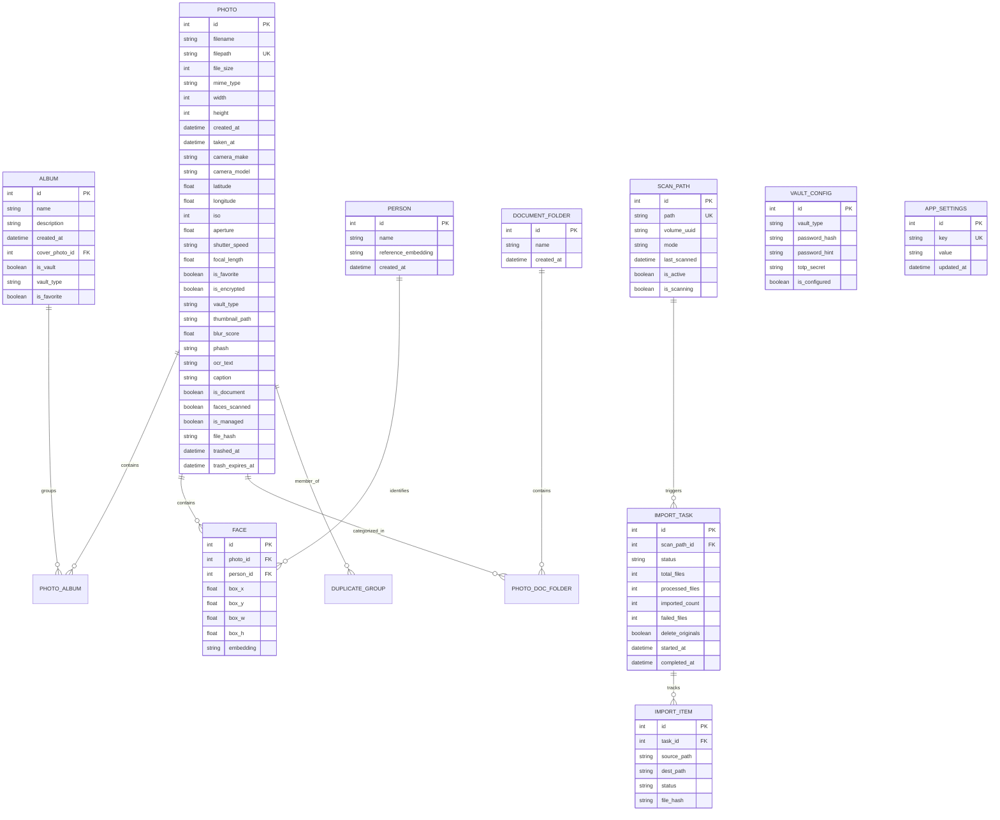

# 🗄️ SecurePhotos 2.0 — Database Schema & Indexing Architecture

> **High-scale SQLite relational engine, composite covering indexes, full-text FTS5 search, and `sqlite-vec` vector index specification for 100,000+ media records.**

---

## 1. Engine Configuration & SQLite Pragmas

To achieve single-digit millisecond query latency across 100,000+ photos on standard NVMe/SSD storage, the SQLite connection executes these pragmas at boot:

```sql
PRAGMA journal_mode = WAL;          -- Write-Ahead Logging for concurrent reads while background workers write
PRAGMA synchronous = NORMAL;        -- Optimal durability without disk flush latency on every write
PRAGMA cache_size = -64000;         -- 64 MB dedicated in-memory page cache
PRAGMA temp_store = MEMORY;         -- Store temp tables, indices, and sorting runs in RAM
PRAGMA mmap_size = 268435456;       -- 256 MB memory-mapped file access for fast sequential scans
PRAGMA busy_timeout = 5000;         -- Wait up to 5000ms on table lock before raising busy error
PRAGMA foreign_keys = ON;           -- Enforce relational foreign key constraints
```

---

## 2. Entity-Relationship Schema



---

## 3. Relational Table Definitions (DDL)

```sql
-- ── 1. Photos Table ──────────────────────────────────────────────────────────
CREATE TABLE IF NOT EXISTS photos (
    id INTEGER PRIMARY KEY AUTOINCREMENT,
    filename TEXT NOT NULL,
    filepath TEXT NOT NULL UNIQUE,
    file_size INTEGER NOT NULL,
    mime_type TEXT DEFAULT 'image/jpeg',
    width INTEGER,
    height INTEGER,
    created_at DATETIME DEFAULT CURRENT_TIMESTAMP,
    taken_at DATETIME,
    camera_make TEXT,
    camera_model TEXT,
    latitude REAL,
    longitude REAL,
    iso INTEGER,
    aperture REAL,
    shutter_speed TEXT,
    focal_length REAL,
    is_favorite BOOLEAN DEFAULT 0,
    is_encrypted BOOLEAN DEFAULT 0,
    encryption_key_id TEXT,
    vault_type TEXT,                -- 'documents' | 'private' | NULL
    thumbnail_path TEXT,            -- Sharded relative path: 'thumbnails/ab/ab12cd....jpg'
    blur_score REAL,
    phash TEXT,
    ocr_text TEXT,                  -- Extracted text from documents/receipts
    caption TEXT,                   -- AI-generated scene description
    content_tags TEXT,              -- Comma-separated or JSON tags
    quality_score REAL,
    is_document BOOLEAN DEFAULT 0,
    sensitivity_reviewed BOOLEAN DEFAULT 0,
    faces_scanned BOOLEAN DEFAULT 0,
    is_managed BOOLEAN DEFAULT 0,
    original_path TEXT,
    file_hash TEXT,                 -- SHA-256 checksum for deduplication
    folder_name TEXT,
    is_optimized BOOLEAN DEFAULT 0,
    trashed_at DATETIME,
    trash_expires_at DATETIME
);

-- ── 2. Albums Table ──────────────────────────────────────────────────────────
CREATE TABLE IF NOT EXISTS albums (
    id INTEGER PRIMARY KEY AUTOINCREMENT,
    name TEXT NOT NULL,
    description TEXT,
    created_at DATETIME DEFAULT CURRENT_TIMESTAMP,
    cover_photo_id INTEGER REFERENCES photos(id) ON DELETE SET NULL,
    is_vault BOOLEAN DEFAULT 0,
    vault_type TEXT,
    is_favorite BOOLEAN DEFAULT 0
);

-- ── 3. Photo ↔ Album Junction ────────────────────────────────────────────────
CREATE TABLE IF NOT EXISTS photo_album (
    photo_id INTEGER NOT NULL REFERENCES photos(id) ON DELETE CASCADE,
    album_id INTEGER NOT NULL REFERENCES albums(id) ON DELETE CASCADE,
    added_at DATETIME DEFAULT CURRENT_TIMESTAMP,
    PRIMARY KEY (photo_id, album_id)
);

-- ── 4. Persons Table ─────────────────────────────────────────────────────────
CREATE TABLE IF NOT EXISTS persons (
    id INTEGER PRIMARY KEY AUTOINCREMENT,
    name TEXT NOT NULL,
    reference_embedding TEXT,       -- JSON array of 512 floats (MobileFaceNet)
    created_at DATETIME DEFAULT CURRENT_TIMESTAMP
);

-- ── 5. Faces Table ───────────────────────────────────────────────────────────
CREATE TABLE IF NOT EXISTS faces (
    id INTEGER PRIMARY KEY AUTOINCREMENT,
    photo_id INTEGER NOT NULL REFERENCES photos(id) ON DELETE CASCADE,
    person_id INTEGER REFERENCES persons(id) ON DELETE SET NULL,
    box_x REAL NOT NULL,            -- Relative coordinates (0.0 to 1.0)
    box_y REAL NOT NULL,
    box_w REAL NOT NULL,
    box_h REAL NOT NULL,
    embedding TEXT NOT NULL          -- 512-D MobileFaceNet embedding vector
);

-- ── 6. Document Folders Table ────────────────────────────────────────────────
CREATE TABLE IF NOT EXISTS document_folders (
    id INTEGER PRIMARY KEY AUTOINCREMENT,
    name TEXT NOT NULL UNIQUE,      -- e.g. 'Invoices', 'Passports', 'Receipts'
    created_at DATETIME DEFAULT CURRENT_TIMESTAMP
);

-- ── 7. Photo ↔ Document Folder Junction ──────────────────────────────────────
CREATE TABLE IF NOT EXISTS photo_document_folder (
    photo_id INTEGER NOT NULL REFERENCES photos(id) ON DELETE CASCADE,
    folder_id INTEGER NOT NULL REFERENCES document_folders(id) ON DELETE CASCADE,
    PRIMARY KEY (photo_id, folder_id)
);

-- ── 8. Scan Paths Table ──────────────────────────────────────────────────────
CREATE TABLE IF NOT EXISTS scan_paths (
    id INTEGER PRIMARY KEY AUTOINCREMENT,
    path TEXT NOT NULL UNIQUE,
    volume_uuid TEXT,
    mode TEXT DEFAULT 'scan',       -- 'scan' (in-place) or 'import' (managed library)
    last_scanned DATETIME,
    is_active BOOLEAN DEFAULT 1,
    is_scanning BOOLEAN DEFAULT 0,
    scan_total INTEGER DEFAULT 0,
    scan_processed INTEGER DEFAULT 0
);

-- ── 9. Transactional Import Tasks ────────────────────────────────────────────
CREATE TABLE IF NOT EXISTS import_tasks (
    id INTEGER PRIMARY KEY AUTOINCREMENT,
    scan_path_id INTEGER REFERENCES scan_paths(id) ON DELETE SET NULL,
    scan_path TEXT,
    status TEXT DEFAULT 'queued',   -- 'queued' | 'scanning' | 'importing' | 'completed' | 'failed'
    total_files INTEGER DEFAULT 0,
    processed_files INTEGER DEFAULT 0,
    imported_count INTEGER DEFAULT 0,
    failed_files INTEGER DEFAULT 0,
    delete_originals BOOLEAN DEFAULT 0,
    started_at DATETIME,
    completed_at DATETIME,
    error_message TEXT
);

-- ── 10. Import Items ─────────────────────────────────────────────────────────
CREATE TABLE IF NOT EXISTS import_items (
    id INTEGER PRIMARY KEY AUTOINCREMENT,
    task_id INTEGER NOT NULL REFERENCES import_tasks(id) ON DELETE CASCADE,
    source_path TEXT NOT NULL,
    dest_path TEXT,
    status TEXT DEFAULT 'pending',  -- 'pending' | 'imported' | 'skipped' | 'failed'
    file_hash TEXT,
    error_message TEXT
);

-- ── 11. Vault Configurations Table ───────────────────────────────────────────
CREATE TABLE IF NOT EXISTS vault_configs (
    id INTEGER PRIMARY KEY AUTOINCREMENT,
    vault_type TEXT NOT NULL UNIQUE, -- 'private' or 'documents'
    password_hash TEXT NOT NULL,     -- bcrypt hash
    password_hint TEXT,
    totp_secret TEXT,                -- Encrypted secret key for RFC 6238 TOTP
    is_configured BOOLEAN DEFAULT 0,
    created_at DATETIME DEFAULT CURRENT_TIMESTAMP,
    updated_at DATETIME DEFAULT CURRENT_TIMESTAMP
);

-- ── 12. App Settings Table ───────────────────────────────────────────────────
CREATE TABLE IF NOT EXISTS app_settings (
    id INTEGER PRIMARY KEY AUTOINCREMENT,
    key TEXT NOT NULL UNIQUE,
    value TEXT NOT NULL,
    updated_at DATETIME DEFAULT CURRENT_TIMESTAMP
);

-- ── 13. Duplicate Groups Table ───────────────────────────────────────────────
CREATE TABLE IF NOT EXISTS duplicate_groups (
    id INTEGER PRIMARY KEY AUTOINCREMENT,
    group_id TEXT NOT NULL,
    photo_id INTEGER NOT NULL REFERENCES photos(id) ON DELETE CASCADE,
    match_type TEXT NOT NULL,        -- 'exact' (hash) or 'near' (phash)
    distance INTEGER DEFAULT 0,
    created_at DATETIME DEFAULT CURRENT_TIMESTAMP
);
```

---

## 4. Composite Covering Indexes

These indexes eliminate table scans during high-frequency UI queries (e.g. infinite scrolling, date filtering, favorites):

```sql
-- Fast library timeline ordering & pagination (excluding trashed/encrypted)
CREATE INDEX IF NOT EXISTS ix_photos_active_taken 
ON photos (is_encrypted, trashed_at, taken_at DESC);

-- Fast favorites timeline
CREATE INDEX IF NOT EXISTS ix_photos_fav_taken 
ON photos (is_favorite, is_encrypted, trashed_at, taken_at DESC);

-- Vault partitioned listing
CREATE INDEX IF NOT EXISTS ix_photos_vault_type 
ON photos (is_encrypted, vault_type, created_at DESC);

-- Trash purge worker queries
CREATE INDEX IF NOT EXISTS ix_photos_trash_expires 
ON photos (trash_expires_at) WHERE trash_expires_at IS NOT NULL;

-- Deduplication lookups by SHA-256 hash
CREATE INDEX IF NOT EXISTS ix_photos_file_hash 
ON photos (file_hash);

-- Perceptual hash near-duplicate search
CREATE INDEX IF NOT EXISTS ix_photos_phash 
ON photos (phash) WHERE phash IS NOT NULL;

-- AI background worker batching queries
CREATE INDEX IF NOT EXISTS ix_photos_ai_pending 
ON photos (faces_scanned, is_encrypted, trashed_at) WHERE faces_scanned = 0;

-- Relational lookups
CREATE INDEX IF NOT EXISTS ix_faces_photo_id ON faces (photo_id);
CREATE INDEX IF NOT EXISTS ix_faces_person_id ON faces (person_id);
CREATE INDEX IF NOT EXISTS ix_photo_album_album_id ON photo_album (album_id);
CREATE INDEX IF NOT EXISTS ix_import_items_task_id ON import_items (task_id);
```

---

## 5. Dual-Branch Hybrid Search Indexes

### A. Full-Text Search (SQLite FTS5)
For instantaneous keyword, tag, and document OCR searches:

```sql
CREATE VIRTUAL TABLE IF NOT EXISTS photos_fts USING fts5(
    filename,
    folder_name,
    caption,
    content_tags,
    ocr_text,
    content='photos',
    content_rowid='id'
);

-- Triggers to keep FTS5 synchronized automatically
CREATE TRIGGER IF NOT EXISTS photos_ai AFTER INSERT ON photos BEGIN
  INSERT INTO photos_fts(rowid, filename, folder_name, caption, content_tags, ocr_text)
  VALUES (new.id, new.filename, new.folder_name, new.caption, new.content_tags, new.ocr_text);
END;

CREATE TRIGGER IF NOT EXISTS photos_ad AFTER DELETE ON photos BEGIN
  INSERT INTO photos_fts(photos_fts, rowid, filename, folder_name, caption, content_tags, ocr_text)
  VALUES('delete', old.id, old.filename, old.folder_name, old.caption, old.content_tags, old.ocr_text);
END;

CREATE TRIGGER IF NOT EXISTS photos_au AFTER UPDATE ON photos BEGIN
  INSERT INTO photos_fts(photos_fts, rowid, filename, folder_name, caption, content_tags, ocr_text)
  VALUES('delete', old.id, old.filename, old.folder_name, old.caption, old.content_tags, old.ocr_text);
  INSERT INTO photos_fts(rowid, filename, folder_name, caption, content_tags, ocr_text)
  VALUES (new.id, new.filename, new.folder_name, new.caption, new.content_tags, new.ocr_text);
END;
```

### B. Vector Embeddings (`sqlite-vec`)
For natural language semantic text-to-image queries:

```sql
CREATE VIRTUAL TABLE IF NOT EXISTS vec_photos USING vec0(
    photo_id INTEGER PRIMARY KEY,
    embedding float[512] distance_metric=cosine
);
```
