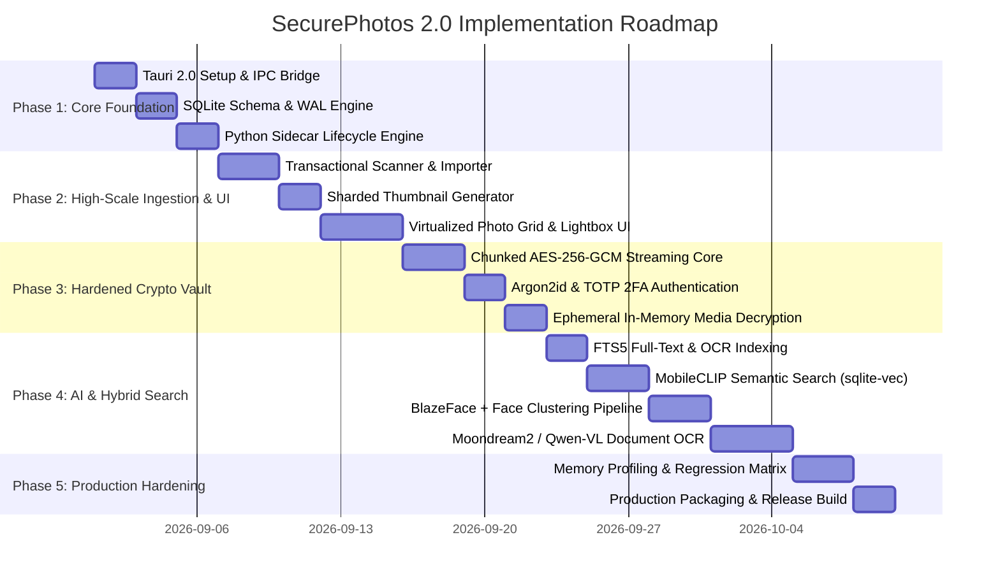

# 🗺️ SecurePhotos 2.0 — End-to-End Implementation Plan

> **Comprehensive multi-phase execution blueprint for building a high-scale, memory-efficient, SLM-powered desktop photo library and digital vault using Tauri 2.0 and Python.**

---

## 📑 Implementation Overview

---

## 📌 Phase 1: Core Foundation & Process Orchestration

### Goals:
Establish a clean, lightweight desktop container using **Tauri 2.0** and scaffold the **Python FastAPI sidecar** with dynamic port discovery, SQLite database configuration, and bidirectional IPC health monitoring.

### Deliverables:
1. **Tauri 2.0 Rust Project Scaffold**:
   - Frameless native window with custom title bar and window control buttons.
   - Child process spawner: finds free port, starts Python sidecar, monitors PID.
   - Splash screen display during cold boot until `/health` responds.
2. **Python FastAPI Sidecar Scaffold**:
   - `main.py` entrypoint accepting `--port` argument.
   - Pydantic V2 settings and strict localhost CORS policy.
   - SQLite database initialization with WAL mode pragmas (`database.py`).
   - Idempotent schema migration runner (`run_migrations()`).
3. **Automated Verification**:
   - Unit test for SQLite connection pragmas (`WAL`, `mmap`, `cache_size`).
   - Integration test verifying clean process shutdown with zero orphaned processes on exit.

---

## 📌 Phase 2: Ingestion Pipeline & Virtualized UI System

### Goals:
Deliver sub-millisecond library browsing across 100,000+ media assets with 60fps virtualized scrolling and non-blocking background directory scanning.

### Deliverables:
1. **Design System & Tokens (`index.css`)**:
   - CSS tokens for dual Dark & Light themes (`--bg-app`, `--accent-primary`, etc.).
   - Aspect ratio skeleton placeholders preventing layout shifts (CLS = 0).
2. **60 FPS Virtualized Grid Component**:
   - `@tanstack/react-virtual` masonry and row-virtualized grid.
   - Dynamic column calculations matching viewport width.
   - Localized multi-selection state store (Zustand `Set<number>`).
3. **Fluid Lightbox Component**:
   - Smooth zoom & pan with mouse-wheel and gestures.
   - EXIF Metadata sidebar drawer (`Ctrl + I`).
   - Full keyboard navigation (`J`/`K`/`Space`/`F`/`L`/`Delete`/`Esc`).
4. **Multi-Threaded Scanner & Thumbnail Sharder**:
   - Recursive scanner using `os.scandir` with batch commits (100 items).
   - EXIF metadata parser (Date taken, GPS coordinates, Camera, ISO, F-Stop).
   - Multi-size Lanczos thumbnail generator storing to `thumbnails/{xx}/{hash}.jpg`.
   - Resumable transactional import engine (`import_tasks` & `import_items`).

---

## 📌 Phase 3: Zero-Trust Hardened Vault

### Goals:
Implement military-grade file and metadata encryption with zero disk-temp leakage and support for multi-gigabyte video files with flat RAM usage.

### Deliverables:
1. **Chunked AES-256-GCM Streaming Cipher**:
   - 64 KB block streaming cipher with 12-byte IV and 16-byte authentication tag.
   - File format specification (.enc) with tamper-detection verification.
2. **Key Derivation & Authentication**:
   - Argon2id / PBKDF2HMAC-SHA256 (100,000 rounds) key derivation.
   - bcrypt PIN/password hashing with work factor 12.
   - RFC 6238 TOTP two-factor authentication with encrypted secret storage.
3. **In-Memory Decryption Streamer**:
   - Fast ephemeral media streaming endpoint (`GET /vault/stream/{id}`).
   - Automatic session timeout (30 seconds idle) with in-memory key zeroing.

---

## 📌 Phase 4: On-Device AI & Hybrid Search Engine

### Goals:
Integrate local, privacy-first computer vision and Small Language Models for instant semantic search, face recognition, and document understanding.

### Deliverables:
1. **Dual Hybrid Search Engine**:
   - **Lexical Branch**: SQLite FTS5 table with automated insert/update/delete triggers.
   - **Semantic Branch**: `sqlite-vec` virtual table storing 512-D MobileCLIP embeddings.
   - **Ranking**: Reciprocal Rank Fusion (RRF) blending keywords and semantic similarities.
2. **Face Detection & Clustering**:
   - MediaPipe BlazeFace for sub-millisecond face bounding-box detection.
   - InsightFace MobileFaceNet ONNX for 512-D identity feature vectors.
   - Cosine similarity clustering for automated person grouping.
3. **Document Intelligence & Vision SLM**:
   - Moondream2 (1.8B INT4 GGUF) or Qwen2.5-VL for OCR and document text extraction.
   - Dynamic memory manager: auto-unloads SLM weights from RAM after 120s of idle time.

---

## 📌 Phase 5: Hardening, Profiling & Production Packaging

### Goals:
Ensure zero memory leaks, full test coverage, and compile standalone cross-platform production installers.

### Deliverables:
1. **Memory & Performance Profiling**:
   - Verify baseline idle memory remains under 80 MB.
   - Verify 60fps scrolling under 100,000 mock photo entries.
2. **Regression & Golden Dataset Test Suite**:
   - Contract tests for all Pydantic schemas.
   - Golden test dataset for face detection, blur scoring, and OCR accuracy.
3. **Tauri 2.0 Production Packaging**:
   - PyInstaller compilation of Python sidecar (`SecurePhotos-engine.exe`).
   - Tauri bundling into signed standalone Windows MSI/EXE installer.
