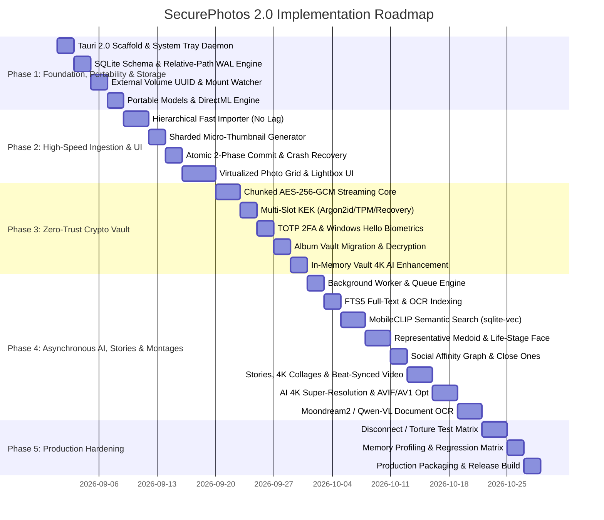

# 🗺️ SecurePhotos 2.0 — End-to-End Implementation Plan

> **Comprehensive multi-phase execution blueprint for building a high-scale, memory-efficient, SLM-powered desktop photo library and digital vault using Tauri 2.0 and Python, with native External Drive Resilience, Multi-Slot Zero-Trust Encryption, Full Album Vault Migration, In-Memory Ephemeral Vault 4K Enhancement, Social Affinity Graph, and Automatic Story & Beat-Matched Video Montage Generation.**

---

## 📑 Implementation Overview

---

## 📌 Phase 1: Core Foundation, Portability & Storage Resilience

### Goals:
Establish a clean, lightweight desktop container using **Tauri 2.0** with **Windows System Tray background execution**, scaffold the **Python FastAPI sidecar** with dynamic port discovery, relative-path SQLite WAL configuration, **External Drive Portability**, and **Hardware-Agnostic Execution Provider Discovery**.

### Deliverables:
1. **Tauri 2.0 Rust Project Scaffold & System Tray Lifecycle**:
   - Frameless native window with custom title bar and window control buttons.
   - Child process spawner: finds free port, starts Python sidecar, monitors PID.
   - **System Tray Daemon**: Option to minimize to Windows System Tray on close to let background AI/transcoding finish silently without UI overhead.
   - **Overnight Mode ("Process & Sleep")**: Executes queued tasks to completion, safely flushes database, and puts host PC to sleep.
2. **External Disk & Volume UUID Tracker**:
   - OS device notification listener (`WM_DEVICECHANGE` on Windows) for plug/unplug events.
   - Volume UUID resolver to seamlessly handle shifting drive letters (`E:\` to `F:\` or `D:\`).
   - Graceful disconnect state: instantly pauses running queues without raising crash exceptions.
3. **Cross-Machine Hardware Portability & Portable Models**:
   - **Portable Models Directory**: Models reside directly on the external drive in `.securephotos_library/models/` (zero re-download when plugged into another machine).
   - **Dynamic Execution Provider Discovery**: Dynamically selects `DirectMLExecutionProvider` (Windows universal GPU/Intel Iris Xe/AMD), `CUDAExecutionProvider` (NVIDIA RTX), or `CPUExecutionProvider` (multi-threaded AVX2/AVX-512 fallback) based on host machine specs.
4. **Python FastAPI Sidecar Scaffold**:
   - `main.py` entrypoint accepting `--port` and `--data-dir` arguments.
   - Pydantic V2 settings and strict localhost CORS policy.
   - Relative-path SQLite database initialization (`database.py`) ensuring zero path breakage across different machines.
   - Idempotent schema migration runner (`run_migrations()`).

---

## 📌 Phase 2: High-Speed Ingestion Pipeline & Virtualized UI System

### Goals:
Deliver instantaneous library ingestion (1,000 photos in seconds) without blocking on heavy AI/transcoding, sub-millisecond browsing across 100,000+ assets with 60fps virtual scrolling, **Hierarchical Disk Sharding**, and **Atomic Two-Phase Commits**.

### Deliverables:
1. **Design System & Tokens (`index.css`)**:
   - CSS tokens for dual Dark & Light themes (`--bg-app`, `--accent-primary`, etc.).
   - Aspect ratio skeleton placeholders preventing layout shifts (CLS = 0).
   - Status indicators for External Disk connection and AI queue activity.
2. **60 FPS Virtualized Grid Component**:
   - `@tanstack/react-virtual` masonry and row-virtualized grid.
   - Dynamic column calculations matching viewport width.
   - Localized multi-selection state store (Zustand `Set<number>`).
3. **Fluid Lightbox Component**:
   - Smooth zoom & pan with mouse-wheel and gestures.
   - EXIF Metadata sidebar drawer (`Ctrl + I`).
   - Interactive Before/After Split Slider for 4K AI enhancement comparison.
   - Full keyboard navigation (`J`/`K`/`Space`/`F`/`L`/`Delete`/`Esc`).
4. **Fast Ingestion & Hierarchical Disk Sharding (Stage 1 — Blazing Speed)**:
   - **Zero AI Delay**: Ingestion strictly performs metadata parsing, fast hash calculation, fast 256px micro-thumbnail creation (10ms), and sharded move/copy. Complete import tasks finish in seconds.
   - **No Flat Folders**: Organizes managed assets on external disk into `originals/YYYY/MM/DD/filename.ext` (< 500 items per folder) to prevent filesystem/OS hangs.
   - **Mode A (Managed Ingestion)**: Interactive modal with explicit options to either *Copy* or *Move & Clean Source*. Source files are verified with matching SHA-256 hashes before any deletion occurs.
   - **Mode B (In-Place Folder Watch)**: Monitored folders on PC remain untouched; metadata and thumbnails are stored on the external drive.
5. **Sharded Micro-Thumbnail Cache**:
   - Multi-size Lanczos thumbnail generator storing to `thumbnails/{xx}/{hash}.webp` (max 256 subfolders, < 500 files each).
   - Resumable transactional import engine (`import_tasks` & `import_items`).
6. **Atomic Two-Phase Commit & Crash Recovery**:
   - Safe in-place file replacement: writes `.filename.4k.tmp`, executes `fsync`, validates checksum/header, and performs atomic `os.replace`.
   - Startup recovery: automatically purges dangling `.tmp` files and resumes interrupted tasks.

---

## 📌 Phase 3: Zero-Trust Hardened Vault & Privacy Isolation

### Goals:
Implement military-grade file and metadata encryption with zero disk-temp leakage, multi-slot key recovery, Authenticator 2FA, bidirectional full album vault migration, and in-memory ephemeral 4K AI enhancement.

### Deliverables:
1. **Chunked AES-256-GCM Streaming Cipher**:
   - 64 KB block streaming cipher with 12-byte IV and 16-byte authentication tag.
   - File format specification (.enc) with tamper-detection verification.
2. **Multi-Slot Master Vault Key Wrapping (MVK)**:
   - Randomized 256-bit Master Vault Key (MVK) generated once.
   - **Slot 1 (Password/PIN)**: MVK wrapped with Argon2id-derived key (memory-hard, GPU-resistant).
   - **Slot 2 (Windows Hello / TPM)**: MVK hardware-bound via Windows DPAPI/TPM for instant 1-second biometric unlock.
   - **Slot 3 (Emergency Recovery Kit)**: MVK wrapped with a 24-word BIP-39 mnemonic / 32-character recovery code for zero-loss password resets.
3. **Authenticator App (RFC 6238 TOTP) & PIN Security**:
   - QR code setup for Google Authenticator / Microsoft Authenticator / Apple Passwords.
   - Encrypted TOTP secret storage and rate-limited PIN verification (bcrypt work factor 12).
4. **Full Album Vault Migration & Decryption (`Move In / Move Out`)**:
   - **Move Album to Vault**: Transactional encryption of all photos in album, thumbnail swapping to `.enc`, setting `album.is_vault = 1`, and removing from public search/timeline.
   - **Move Album Out of Vault**: Transactional decryption back to library format, regenerating public thumbnails, setting `album.is_vault = 0`, and restoring to public timeline.
5. **In-Memory Ephemeral Vault 4K AI Enhancement**:
   - **Zero Disk Footprint**: Vault photo/video decrypted ephemerally into RAM ➔ DirectML AI upscales & AVIF/AV1 compresses in RAM ➔ Re-encrypted with AES-256-GCM before writing `.enc` to disk. Zero unencrypted temp files touch physical storage.
   - **Active Task Keep-Alive & Privacy Shield**: During active batch vault optimizations, the 30s lock timer is held active until completion; if user steps away, the UI displays a Frosted Privacy Shield blurring all photos. Upon 100% completion (or manual cancel), keys are scrubbed with `memset_s` and the vault auto-locks immediately.

---

## 📌 Phase 4: Decoupled Asynchronous AI, Stories & Montage Engine (Stage 2)

### Goals:
Integrate a decoupled, low-priority background worker engine for non-blocking 4K AI Super-Resolution, AVIF/AV1 transcoding, **Representative Medoid Face Clustering**, **Social Affinity Graph**, **Dynamic Stories**, and **Beat-Matched 4K Video Montages**.

### Deliverables:
1. **Asynchronous Background Processing Engine**:
   - Priority worker queue consuming from `optimization_tasks` and `ai_tasks`.
   - Power & Thermal awareness: auto-pauses when on laptop battery or during heavy CPU usage.
   - Interactive UI Control: Real-time progress status pill with manual Pause / Resume / Turbo toggle.
2. **4K AI Super-Resolution & Smart Transcoding**:
   - DirectML/ONNX Super-Resolution model (e.g. `Real-ESRGAN-Compact`) upscales low-res media to 4K resolution.
   - AVIF/WebP (CRF 18) photo compressor & FFmpeg AV1/H.265 video transcoder (50–70% size reduction with visually lossless fidelity).
   - Atomic in-place file swap after verification.
3. **Dual Hybrid Search Engine**:
   - **Lexical Branch**: SQLite FTS5 table with automated insert/update/delete triggers.
   - **Semantic Branch**: `sqlite-vec` virtual table storing 512-D MobileCLIP embeddings.
   - **Ranking**: Reciprocal Rank Fusion (RRF) blending keywords and semantic similarities.
4. **Representative Medoid Clustering & Chronological Life-Stage Bridging**:
   - **YOLOv8-Face + ArcFace (ResNet-50) ONNX**: High-accuracy face detection in multi-person group photos with 5-point affine alignment and 512-D identity embeddings.
   - **Representative Medoid Selection ("Name Once, Tag 1,000 Photos")**: Automatically groups clusters and presents 3–4 diverse anchor faces so naming a person once labels thousands of photos in 1 click.
   - **Temporal Transitive Linkage (Childhood ➔ Adulthood)**: Chronologically bridges aging faces using time-stamped embedding trajectories ($Age 5 \rightarrow Age 8 \rightarrow Age 14 \rightarrow Age 22 \rightarrow Age 30$).
5. **Social Affinity Graph & Close Ones Engine**:
   - Mathematical Affinity Score ($0.0 - 100.0$) combining temporal longevity (30%), group intimacy (25%), co-occurrence frequency (20%), and user star/favorites (25%).
   - Filters out one-off wedding/party guests from story spam while promoting close family and best friends.
6. **Automatic Stories, 4K Collages & Beat-Matched Video Montages**:
   - **Vibe & Mood Classifier**: MobileCLIP zero-shot analysis matching scene visual aesthetics to audio moods (*Serene Acoustic*, *Upbeat Party*, *Nostalgic Piano*, *Epic Adventure*).
   - **Smart 4K Collages**: Geometric aspect-ratio packing (Treemaps) with face-aware bounds protection and color palette harmony.
   - **Beat-Synchronized Video Montage**: Hardware-accelerated FFmpeg/PyAV video renderer with Ken-Burns pan/zoom and cuts synchronized to audio BPM/downbeats. Bundles ~15-20 local royalty-free ambient soundtracks with custom MP3 support.
7. **Document Intelligence & Vision SLM**:
   - Moondream2 (1.8B INT4 GGUF) or Qwen2.5-VL for OCR and document text extraction.
   - Dynamic memory manager: auto-unloads SLM weights from RAM after 120s of idle time.

---

## 📌 Phase 5: Hardening, Profiling & Production Packaging

### Goals:
Ensure zero data loss under disk disconnections, zero memory leaks, full test coverage, and compile standalone cross-platform production installers.

### Deliverables:
1. **Disconnect & Torture Testing**:
   - Automated tests simulating mid-write external USB disconnects to verify zero corruption of originals.
   - Stress testing atomic swaps and task resumption after ungraceful termination.
2. **Cross-Machine Hardware Compatibility Testing**:
   - Test suite executing across NVIDIA GPU, AMD GPU, Intel Iris Xe, and CPU-only configurations.
3. **Memory & Performance Profiling**:
   - Verify baseline idle memory remains under 80 MB.
   - Verify 60fps scrolling under 100,000 mock photo entries.
   - Benchmark 4K video playback memory stability.
4. **Regression & Golden Dataset Test Suite**:
   - Contract tests for all Pydantic schemas.
   - Golden test dataset for face detection, blur scoring, 4K super-resolution fidelity, and OCR accuracy.
5. **Tauri 2.0 Production Packaging**:
   - PyInstaller compilation of Python sidecar (`SecurePhotos-engine.exe`).
   - Tauri bundling into signed standalone Windows MSI/EXE installer with bundled FFmpeg/DirectML binaries.
